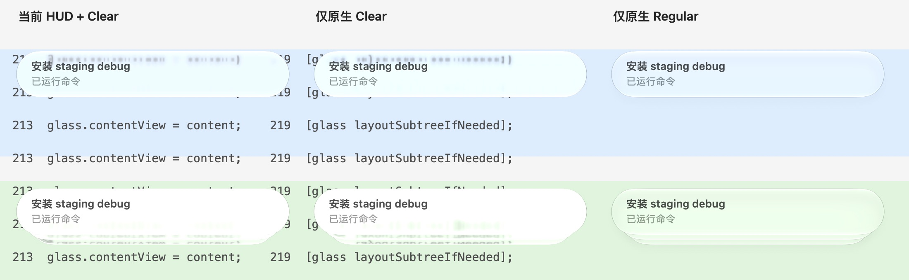
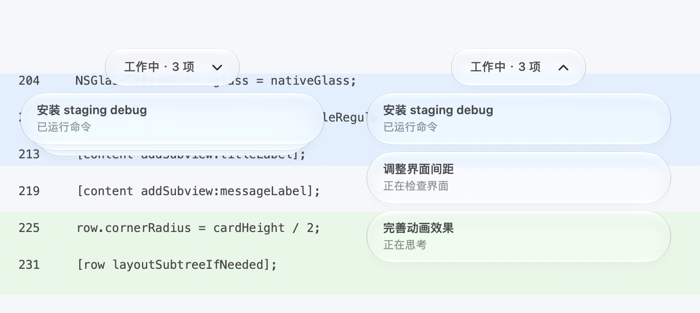

# 原生液态玻璃配置与左右像素缺口修复

当前约定更新于 **2026-10-30**：任务卡片与脚下状态条都使用用户选定的 **Regular Liquid Glass**。宠物在屏幕下半部时，状态条位于宠物下方、卡片向上展开；在上半部时，状态条位于宠物上方、卡片向下展开。默认仍为堆叠，状态条无活动圆点，右侧箭头控制展开、收起。此前状态条的 Clear＋HUD 配置只保留为历史记录。

实现入口：[FishGlassStatus.m](FishGlassStatus.m)，验证入口：[test_task_stack.m](test_task_stack.m)，插件构建：[build.py](build.py)。任务数据和联动协议见 [Codex 接入说明](../../Integrations/codex/README.md)。

## 当前配置

macOS 26 及以上直接使用 `NSGlassEffectView`，让系统完成高光、折射、背景适应和内容处理。任务卡片与状态条都采用以下材料配置：

| 项目 | 当前值 |
| --- | --- |
| 原生视图 | `NSGlassEffectView` |
| 样式 | `NSGlassEffectViewStyleRegular` |
| 额外染色 | `tintColor == nil` |
| 透明度 | 保留系统默认 `alphaValue == 1`，不通过减淡整个玻璃视图模拟通透 |
| 内容承载 | 标题、消息或状态文字放在 `glass.contentView` 内 |
| 额外模糊底层 | 不创建额外的 `NSVisualEffectView` / HUD 材质兄弟视图 |
| 边缘对齐 | 左右各向内对齐半个 backing pixel，见下文公式 |
| 旧系统回退 | 仅 macOS 26 以下使用 `NSVisualEffectView`、`BehindWindow`、`HUDWindow`、`stateActive`；这是兼容回退，不称为液态玻璃 |

原生玻璃不一定向调用者暴露 `CALayer`。验证透明度时允许 `glass.layer == nil`；如果存在 layer，则检查其 opacity 为 1。不要为了让测试通过而给玻璃强行创建额外 layer 或加入自定义模糊滤镜。

### 任务卡片

| 项目 | 当前值 |
| --- | --- |
| 单张卡片 | 330 × 56 pt，圆角 28 pt |
| 面板宽度 | 350 pt，卡片左右各留 10 pt |
| 标题 | 系统字体 13 pt、Semibold、`labelColor` |
| 最新消息 | 系统字体 12 pt、Regular、`secondaryLabelColor` |
| 文字左边距 | 16 pt；布局时扣除玻璃的半像素内缩，使最终坐标仍为 16 pt |
| 标题可用宽度 | 298 pt，不再为右上计数预留位置 |
| 计数 | 卡片上不显示；总数保留在脚下状态条、VoiceOver 和提示文字中 |
| 位置 | 根据宠物中心与所在屏幕可用区域的中线选择：下半屏状态条在下、卡片在其上方；上半屏状态条在上、卡片在其下方。卡片水平对齐状态条，靠边时限制在桌面内 |
| 默认状态 | 前卡片显示标题和最新消息，后方最多露出两层卡片 |
| 后层偏移 | 每层向内缩 8 pt、朝展开方向错开 6 pt，宽度每层减少 16 pt；前层保持靠近状态条 |
| 展开列表 | 行距 64 pt，即卡片高 56 pt＋间隔 8 pt；最高 332 pt，超过后滚动 |
| 操作 | 收起时箭头指向实际展开方向，展开时反向指向收起方向；点击堆叠、箭头或整条状态胶囊可切换，外部点击／打开聊天收回堆叠，消息更新不自动展开 |

展开列表的滚动文档使用 `NSGlassEffectContainerView`，`spacing = 0`，让相邻玻璃共享采样，同时保留行间的空隙。容器和文档高度同步更新。第一项始终靠近状态条，其余项目朝展开方向排布；最近的可见卡片与状态条相隔 8 pt。向下时保存距文档顶部的滚动距离，向上时保存距底部的距离，换边、折叠或消息刷新时保留同一逻辑位置。

展开方向朝向桌面内部，**不再为了展开列表自动平移角色，也不缩小角色或调整相机**。可用空间不足时缩短滚动视口，默认最高 332 pt。状态胶囊和卡片限制在屏幕可用区域内，胶囊的透明阴影留白可延伸到限制范围外。

**重叠的堆叠卡片不整体放进合并容器。** 实测这样会把几层轮廓融成一整块，丢失堆叠边缘；当前堆叠保留独立的原生 Regular 玻璃层。

### 展开与收起动画

展开时，卡片从堆叠位置朝当前展开方向逐张拉开，收起时回到同一锚点。前卡片与状态条的位置保持，后层逐渐展开并淡入；收回时淡出并重新露出空白堆叠边缘。约 300 ms 完成，使用 ease-out 曲线，每层最多错开 14 ms（最多累计 56 ms）。

动画直接复用 `FishTaskRow` 的原生 Regular 玻璃视图，不用卡片截图或 HUD 替代；不改玻璃本身的材质、染色或默认透明度。仅临时过渡行的整体 `alphaValue` 和位置／宽度变化，停稳后仍使用原来的列表／堆叠视图及半像素边缘。临时绘制范围只涵盖当前可见行和前卡片，64 项不会全部创建过渡玻璃层。

`NSTimer` 在主 RunLoop 的 common modes 下按约 60 Hz 请求更新，实际帧率取决于系统调度，不能据此声称稳定 60 fps。快速再次点击会读取当前行的位置和透明度，从该帧反向过渡，不先跳回起点。动画期间到达的任务快照最多延迟这一段过渡，结束后应用最新完整快照；临时行不加入无障碍控件，也不会在移动中误打开聊天。

拖动宠物、换边、隐藏或销毁时取消计时器并清理临时视图，立即回到最新目标状态；保留原有拖动、点击和滚动位置。系统开启“减少动态效果”时直接切换最终视图。动画只是卡片展开／收起，不额外移动或缩放宠物。

### 脚下状态条

状态条与任务卡片使用相同的 Regular 材料，几何和文字配置保持自身的紧凑尺寸：

| 项目 | 当前值 |
| --- | --- |
| 胶囊高度／圆角 | 40 / 20 pt |
| 最小宽度 | 140 pt，根据文字宽度自适应 |
| 透明附件窗口 | 高 60 pt，宽度比胶囊多 24 pt；不扩大角色窗口 |
| 文字 | 系统字体 13 pt、Medium、居中；文字框起点距胶囊左侧 16 pt |
| 活动圆点 | 已移除，包括工作状态的脉冲动画 |
| 折叠按钮 | 右侧原生 SF Symbol `chevron.down` / `chevron.up`，12 pt Semibold；24 × 24 pt 点击区域，右侧留 12 pt；收起时指向展开方向，展开后反向，VoiceOver 同时说明向上／向下 |
| 自适应宽度 | 文字单元的 `cellSize.width`（包含原生内部留白）加 60 pt 后向上对齐到偶数点宽，为左右留白和箭头保留空间，并使窗口像素取整后的卡片中心一致；不小于 140 pt |
| 点击范围 | 完整胶囊，不随玻璃半像素内缩而缩小 |
| 拖动 | 按住状态文字或箭头拖动，移动整个角色窗口及附属卡片；鼠标位移超过 4 pt 后进入拖动，松手不切换展开状态 |
| 既有容器阴影 | 作者参数 opacity .12、radius 4、offset (0, -1.5)；系统合成后的表现可能调整 |

状态条的文字区域和箭头均使用 `FishStatusDragButton`：保存按下时的屏幕坐标和角色窗口起点，后续通过绝对屏幕位移移动父窗口，避免附属窗口跟随移动后产生累积偏移。未超过 4 pt 且在原控件内松手才发送原有点击动作；`performClick:`／无障碍按钮操作仍正常。窗口移动观察器同步状态条、堆叠和展开列表。拖动状态条期间暂时保持原侧，跨过屏幕中线后在松手时切换到另一端，避免按住时控件跳离鼠标；从角色自身拖动或其他窗口位置变化则正常重算。拖动不取得键盘焦点，也不修改任务快照。

状态条和卡片继续直接使用 Regular 玻璃；新增按钮不会叠加 HUD 或自制模糊底层。胶囊仍高 40 pt，宽度按新内容排布自适应，角色窗口大小和相机保持。

## 左右缺像素的修复过程

现象是胶囊最左、最右的圆弧中部有很小的轮廓断点。起初怀疑透明窗口裁剪，但实际试验**没有证明外层窗口裁剪就是根因**；半像素边缘对齐是本机验证有效的修复。

| 阶段 | 处理和结论 |
| --- | --- |
| 状态条早期试验 | 增加透明画布／窗口留白，实际缺口仍存在，未采用 |
| 等待原生窗口稳定 | 等 UniWinC 完成最终尺寸和位置后再创建状态条，保留此生命周期处理；它单独不足以消除断点 |
| 第 155 版 | 玻璃左右各内缩半个 backing pixel，并补偿文字、圆点坐标；用户反馈“断点没了，或者说很轻微了” |
| 其他候选 | `cornerRadius = 999` 曾编译，但没有嵌入或运行，不能把它记为已验证方案 |
| 第 198 版 | 任务卡片漏用了状态条的边缘对齐；将同样的处理补到展开行、堆叠前层及后层 |
| 当前版本 | 两种组件都保留该对齐方法，材料统一为 Regular；仍须结合背景、缩放和实际截图检查 |

核心公式，单位为原生点：

```objc
CGFloat edgeInset = .5 / MAX(1, view.window.backingScaleFactor);
glass.frame = NSInsetRect(authoredBounds, edgeInset, 0);
```

在本机 2× 显示环境中，`edgeInset = 0.25 pt`。330 pt 宽的卡片，其玻璃宽为 329.5 pt；140 pt 宽的状态条，其玻璃宽为 139.5 pt。只调整玻璃采样／绘制边缘，不改变作者胶囊、窗口、点击范围或角色大小。

因为玻璃的起点向右移动了 `edgeInset`，内部内容需要向左补偿同样的距离。例如任务卡片：

```objc
glass.frame = NSInsetRect(row.bounds, edgeInset, 0);
content.frame = NSMakeRect(0, 0,
    row.bounds.size.width - 2 * edgeInset, row.bounds.size.height);
// title/message 仍位于 glass.contentView 中。
titleFrame.origin.x = messageFrame.origin.x = 16 - edgeInset;
button.frame = row.bounds;
```

当前状态条文字使用 `16 - edgeInset`，箭头按钮使用 `width - 36 - edgeInset`；旧版圆点现已移除。任务卡片在 `viewDidMoveToWindow` 和 `viewDidChangeBackingProperties` 中请求重新布局；状态条通过 `LayoutStatus` 随窗口移动、屏幕变化和状态刷新重算 backing scale。不要把 0.25 pt 写死为所有显示器的值，也不要只挪动玻璃而遗漏文字补偿。

## 为什么没有继续调 Material 透明度

第 199 版曾保留 Clear 玻璃，把额外 HUD 底层从 .58 降到 .18。虽然背景更浅，用户仍认为它像普通 Material，未接受该质感。它确实包含 `NSGlassEffectView`，但仅检查类名或调低底层透明度不足以证明视觉效果符合目标。

第 200 版在相同背景下比较了“HUD＋Clear”“纯 Clear”“纯 Regular”，最终选用纯原生 Regular，移除额外 HUD。任务卡片效果随后获用户确认，状态条也按用户后续要求统一到此配置。

以下为当时的原生组件对照，从左到右依次是 HUD＋Clear、纯 Clear、纯 Regular：



当前统一配置的组件预览：左侧示范下半屏的状态条在下、卡片向上；右侧示范上半屏的状态条在上、卡片向下。两侧均已展开，箭头指向各自的收起方向；第一项靠近状态条。



两张图均使用固定示例任务和合成代码／色块背景，不含真实聊天消息；不是 Codex Mini 截图，也不是完整桌面截图。普通窗口截图有时会遗漏窗口背后的内容或将透明区域合成为白色，不能单凭白底 app 截图推断所有桌面背景下的通透度。

## 失焦时维持玻璃效果

状态条和任务列表都是透明、无边框、非激活的附属 `NSPanel`，`hidesOnDeactivate = NO`。它们不能成为真实 key/main window，因此不会为了维持玻璃而抢键盘焦点。

当前 `FishActiveStatusPanel` 仅对 `_hasActiveAppearance`、`_hasActiveAppearanceIgnoringKeyFocus` 返回 YES，影响绘制外观；`isKeyWindow` 和 `NSApp.keyWindow` 保持真实状态。刷新时对 `_setForceActiveControls:`、`setNativeGlassForcesActiveAppearance:`、`_sendForcedWindowChangedKeyState` 逐一检查是否支持，再调用；`refreshingAppearance`、`layingOut` 防止通知递归。

这些外观钩子属于 AppKit SPI，不能当成公开、稳定的跨版本保证。后续修改必须保留 selector 检查，并核对实际失焦状态。不要通过伪造 `isKeyWindow` 或强制激活应用修复玻璃。

## 构建与验证

以下命令从仓库根目录执行，需要已登录图形桌面的 macOS 和支持相关 API 的 Xcode Command Line Tools／SDK：

```sh
mkdir -p work/glass-check
xcrun clang -fobjc-arc -framework Cocoa -framework QuartzCore \
  Native/FishStatusGlass/test_task_stack.m -o work/glass-check/task-stack-test
work/glass-check/task-stack-test
python3 Native/FishStatusGlass/build.py
```

原生测试覆盖动画的中间帧、真实计时器连续更新、双向展开／收起、快速反转、任务快照延后更新、拖动／隐藏／销毁取消及即时切换路径；同时覆盖两类组件的 Regular／无 HUD／默认 opacity、`contentView`、圆角、半像素边缘、文字及点击坐标；同时覆盖 0/1/2/3/6/64 项、无活动圆点／可见卡片计数、右侧按钮命中和状态、文字／箭头拖动时整组窗口位移、轻微抖动与点击区分／松手不误展开、短状态文字完整显示、上下半屏的双向布局、堆叠与首项锚点、换边后的逻辑滚动位置、按住跨中线到松手的切换、屏幕边缘留白与角色位置／尺寸保持、展开／外部点击收起、120 pt 滚动位置保留、无障碍入口、隐藏／显示和销毁清理。

`build.py` 为 arm64 构建插件，最低部署目标为 macOS 12；Liquid Glass 分支要求 macOS 26。脚本按 `FishGlassStatus.m` 与自身内容生成指纹，签名并验证插件。仅编译原生插件不会更新已经运行的应用；还须构建应用并重启对应进程。先将 `UNITY_EDITOR_PATH` 指向本机 Unity 2022.3.22f1 的可执行文件：

```sh
mkdir -p Logs
"$UNITY_EDITOR_PATH" -batchmode -projectPath "$PWD" \
  -executeMethod DesktopFish.Editor.FishLowPoly5KDelivery.Build \
  -quit -logFile Logs/task-glass-build.log
codesign --verify --strict Assets/DesktopFish/Plugins/macOS/FishGlassStatus.bundle
codesign --verify --deep --strict Builds/RebuiltBigFish.app
```

必须检查完整 Unity 日志，拒绝 `error CS...`、异常、着色器错误或 executeMethod 抛错；即使退出码为 0、后面又出现成功也不能通过。成功日志还应同时包含 `Build Finished, Result: Success.` 和 `5K application build completed.`。构建后核对应用内插件与选定插件一致，用构建前快照恢复仅由本次构建引入的 ProjectSettings 变化、保留用户已有修改，再启动新进程；不覆盖旧 `Builds/BigFatBlueFish.app`。

人工验收需看白底和有颜色／文字的背景，分别检查堆叠、展开、滚动和真实任务更新，并核对聚焦与失焦。第 200 版已核对实际应用的初始失焦状态，不能把一次初始状态截图当作全部焦点切换过程的证明。界面改动若未改变模型、蒙皮、表情或骨骼，无须机械重跑整套模型动作；保留模型、旧应用及运行时文件的 SHA 核对。

## 历史基线与材料位置

| 记录 | 作用 |
| --- | --- |
| `2ef85e5`（155） | 状态条半像素对齐获用户认可；当时仍用旧材料配置 |
| `08cfe91`（198） | 半像素对齐补到任务卡片 |
| `30415c0`（199） | 收窄至 330×56、去掉可见计数；此版 Material-like 质感随后被否决 |
| `4371f88`（200） | 用户确认的任务卡片纯原生 Regular 配置 |
| `96bd0b8`（201） | 状态条也统一为纯原生 Regular，并加入本文档 |
| `0869040`（202） | 卡片移到状态条下方，去掉活动圆点，加入可见折叠按钮；保留材料和半像素修复 |
| `47f3610`（203） | 拖动状态条文字或箭头可移动整个宠物；保留点击折叠、展开 |
| `33e0c32`（204） | 状态条随宠物位于上下侧，卡片朝桌面内部展开；取消展开时自动挪动角色，松手再切换拖动锚点 |
| 本文档对应源码（205） | 约 300 ms 原生卡片展开／收起动画，支持从当前帧反转、快照刷新延后及中断清理 |

本机详细日志和试验保留在 `work/status-glass-155/`、`work/task-glass-edges-198/`、`work/task-mini-style-199/`、`work/task-native-glass-200/`、`work/glass-config-docs-201/`、`work/task-below-status-202/`、`work/status-drag-203/`、`work/adaptive-task-direction-204/`、`work/task-card-motion-205/`；`work/` 不入库，本文及上方两张固定示例图不依赖这些本机记录即可阅读。

官方原理参考：[NSGlassEffectView](https://developer.apple.com/documentation/appkit/nsglasseffectview)、[Build an AppKit app with the new design](https://developer.apple.com/videos/play/wwdc2025/310/)。实现和验证范围以当前源码、原生测试及上述记录为准，不宣称精确复刻 Mini 或覆盖全部系统版本、壁纸和缩放组合。
