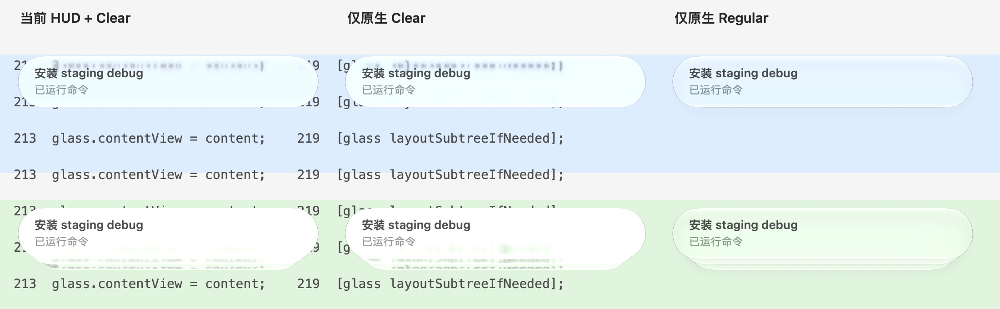
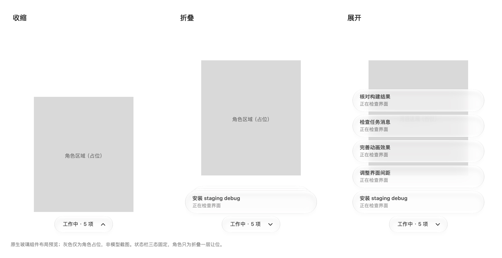
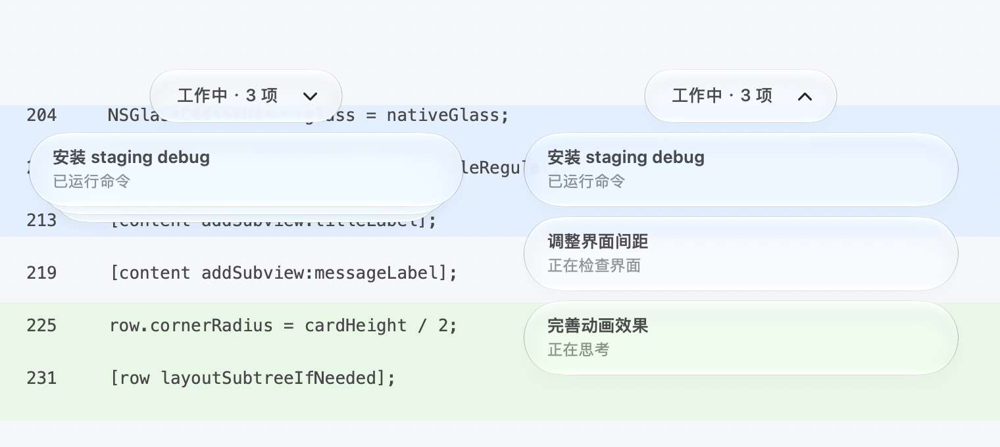

# 原生液态玻璃配置与左右像素缺口修复

当前约定更新于 **2026-11-04**：任务卡片与脚下状态条都使用用户选定的 **Regular Liquid Glass**。状态条始终位于宠物下方，任务卡片统一向上展开；拖到屏幕上半部或跨过中线也不换边。多任务支持收缩、折叠、展开三态；单任务只有隐藏／显示一张卡片，点击卡片直接进入对应Codex聊天。同一停靠点的状态条保持固定，宠物只为卡片让位，列表展开时不追加位移。桌宠与附件统一使用普通浮动窗口层级，置于普通应用之上，并让出系统面板。状态条无活动圆点。此前状态条的 Clear＋HUD 配置只保留为历史记录。

实现入口：[FishGlassStatus.m](FishGlassStatus.m)，验证入口：[test_task_stack.m](test_task_stack.m)，插件构建：[build.py](build.py)。任务数据和联动协议见 [Codex 接入说明](../../Integrations/codex/README.md)。

## 当前配置

macOS 26 及以上直接使用 `NSGlassEffectView`，让系统完成高光、折射、背景适应和内容处理。任务卡片与状态条都采用以下材料配置：

| 项目 | 当前值 |
| --- | --- |
| 原生视图 | `NSGlassEffectView` |
| 样式 | `NSGlassEffectViewStyleRegular` |
| 额外染色 | `tintColor == nil` |
| 透明度 | 保留系统默认 `alphaValue == 1`，不通过减淡整个玻璃视图模拟通透 |
| 内容承载 | 标题、消息或状态文字放在 `glass.contentView` 内 |
| 额外模糊底层 | 不创建额外的 `NSVisualEffectView` / HUD 材质兄弟视图 |
| 边缘对齐 | 左右各向内对齐半个 backing pixel，见下文公式 |
| 旧系统回退 | 仅 macOS 26 以下使用 `NSVisualEffectView`、`BehindWindow`、`HUDWindow`、`stateActive`；这是兼容回退，不称为液态玻璃 |

原生玻璃不一定向调用者暴露 `CALayer`。验证透明度时允许 `glass.layer == nil`；如果存在 layer，则检查其 opacity 为 1。不要为了让测试通过而给玻璃强行创建额外 layer 或加入自定义模糊滤镜。

### 任务卡片

| 项目 | 当前值 |
| --- | --- |
| 单张卡片 | 330 × 56 pt，圆角 28 pt |
| 面板宽度 | 350 pt，卡片左右各留 10 pt |
| 标题 | 系统字体 13 pt、Semibold、`labelColor` |
| 最新消息 | 系统字体 12 pt、Regular、`secondaryLabelColor` |
| 文字左边距 | 16 pt；布局时扣除玻璃的半像素内缩，使最终坐标仍为 16 pt |
| 标题可用宽度 | 298 pt，不再为右上计数预留位置 |
| 计数 | 卡片上不显示；总数保留在脚下状态条、VoiceOver 和提示文字中 |
| 位置 | 状态条始终在宠物下方，卡片始终在状态条上方向上展开，不根据屏幕中线换边。卡片水平对齐状态条，靠边时限制在桌面内 |
| 默认状态 | 前卡片显示标题和最新消息，后方最多露出两层卡片 |
| 后层偏移 | 每层向内缩 8 pt、朝展开方向错开 6 pt，宽度每层减少 16 pt；前层保持靠近状态条 |
| 展开列表 | 行距 64 pt，即卡片高 56 pt＋间隔 8 pt；最高 332 pt，超过后滚动 |
| 操作 | 箭头（或状态胶囊）从展开先折叠，再次点击完全收缩；收缩后点击显示折叠卡片。点击堆叠展开，外部点击／打开聊天退回折叠，消息刷新不自动展开或取消用户的收缩选择 |

三态位置遵循用户提供的示意：

| 状态 | 卡片 | 宠物位置 | 状态条 |
| --- | --- | --- | --- |
| 收缩 | 完全不显示 | 比基础原位远离状态条 8 pt | 固定停靠点 |
| 折叠 | 一摞卡片 | 为这一摞向上让出空间 | 同一固定停靠点 |
| 展开 | 从堆叠相同近端边缘铺开列表，可覆盖角色区域 | 与折叠状态完全相同 | 同一固定停靠点 |

当前间距按用户要求分开调整：完全收缩时，人物与状态条的间距增加 8 pt；卡片折叠时，人物与卡片的间距减少 16 pt。状态条和卡片锚点保持固定，通过角色位移实现。折叠／展开的预留量为折叠画布高度加 8 pt 再减 16 pt：1／2／3 层分别为 64／70／76 pt，更多任务不继续增加；完全收缩位移为 8 pt，因此收缩到折叠实际移动 56／62／68 pt。展开沿用折叠的人物位置。窗口大小、模型及相机均保持；“固定”指三态切换期间的位置，手动拖动仍移动整组。`PetDockFrame()` 从实际窗口扣除已应用位移保存逻辑停靠点，状态条按此点布局；每帧恢复附属窗口位置，避免随角色的让位动作一起漂移。位移采用 NSWindow 实际落点，防止屏幕取整累积误差。

手动拖动跨过屏幕中线、松手或更换屏幕时，状态条始终保持在角色下方，不再运行自动选边或换边重建。安全范围内保留精确拖动终点；太靠近边缘或拖出屏幕后，按下述整组边距回弹。

展开列表的滚动文档使用 `NSGlassEffectContainerView`，`spacing = 0`，让相邻玻璃共享采样，同时保留行间的空隙。容器和文档高度同步更新。第一项始终靠近状态条，其余项目朝展开方向排布；最近的可见卡片与状态条相隔 8 pt。始终保存距文档底部锚点的滚动距离，拖动、折叠或消息刷新时保留同一逻辑位置。

展开方向统一向上，**从折叠展开列表时不再平移角色**；只有收缩与折叠之间预留／释放那一摞的位置，不缩小角色或调整相机。可用空间不足时缩短滚动视口，默认最高 332 pt。状态胶囊和卡片限制在屏幕可用区域内，胶囊的透明阴影留白可延伸到限制范围外。

**重叠的堆叠卡片不整体放进合并容器。** 实测这样会把几层轮廓融成一整块，丢失堆叠边缘；当前堆叠保留独立的原生 Regular 玻璃层。

### 展开与收起动画

展开时，卡片从堆叠位置朝当前展开方向逐张拉开，收起时回到同一锚点。前卡片与状态条的位置保持，后层逐渐展开并淡入；收回时淡出并重新露出空白堆叠边缘。约 300 ms 完成，使用 ease-out 曲线，每层最多错开 14 ms（最多累计 56 ms）。

动画直接复用 `FishTaskRow` 的原生 Regular 玻璃视图，不用卡片截图或 HUD 替代；不改玻璃本身的材质、染色或默认透明度。仅临时过渡行的整体 `alphaValue` 和位置／宽度变化，停稳后仍使用原来的列表／堆叠视图及半像素边缘。临时绘制范围只涵盖当前可见行和前卡片，64 项不会全部创建过渡玻璃层。

`NSTimer` 在主 RunLoop 的 common modes 下按约 60 Hz 请求更新，实际帧率取决于系统调度，不能据此声称稳定 60 fps。快速再次点击会读取当前行的位置和透明度，从该帧反向过渡，不先跳回起点。动画期间到达的任务快照最多延迟这一段过渡，结束后应用最新完整快照；临时行不加入无障碍控件，也不会在移动中误打开聊天。

收缩与折叠之间也由同一计时器过渡：卡片淡入／淡出，角色同步让位／回原位，状态条保持不动；快速反转从当前实际角色位移和卡片透明度继续。折叠与展开之间角色位置固定。拖动、隐藏或销毁时取消计时器、清理临时视图并收敛到目标状态；销毁时还原未预留空间的角色位置。系统开启“减少动态效果”时直接切换，不修改个人设置。

### 脚下状态条

状态条与任务卡片使用相同的 Regular 材料，几何和文字配置保持自身的紧凑尺寸：

| 项目 | 当前值 |
| --- | --- |
| 胶囊高度／圆角 | 40 / 20 pt |
| 与角色的距离 | 按用户红框，将原停靠点朝角色方向内移 40 pt（一条状态胶囊的高度）；状态条在脚下上移，横向中心不变；已取消上方状态条布局 |
| 最小宽度 | 140 pt，根据文字宽度自适应 |
| 透明附件窗口 | 高 60 pt，宽度比胶囊多 24 pt；不扩大角色窗口 |
| 文字 | 系统字体 13 pt、Medium、居中；文字框起点距胶囊左侧 16 pt |
| 活动圆点 | 已移除，包括工作状态的脉冲动画 |
| 折叠按钮 | 右侧原生 SF Symbol `chevron.down` / `chevron.up`，12 pt Semibold；24 × 24 pt 点击区域，右侧留 12 pt；完全收缩时指向显示方向，折叠／展开时反向；VoiceOver 分别说明“显示任务卡片”“收缩任务卡片”“折叠任务列表”及固定向上展开方向 |
| 自适应宽度 | 文字单元的 `cellSize.width`（包含原生内部留白）加 60 pt 后向上对齐到偶数点宽，为左右留白和箭头保留空间，并使窗口像素取整后的卡片中心一致；不小于 140 pt |
| 点击范围 | 完整胶囊，不随玻璃半像素内缩而缩小 |
| 拖动 | 按住状态文字或箭头拖动，移动整个角色窗口及附属卡片；鼠标位移超过 4 pt 后进入拖动，松手不切换展开状态 |
| 既有容器阴影 | 作者参数 opacity .12、radius 4、offset (0, -1.5)；系统合成后的表现可能调整 |

状态条的文字区域和箭头均使用 `FishStatusDragButton`：保存按下时的屏幕坐标和角色窗口起点，后续通过绝对屏幕位移移动父窗口，避免附属窗口跟随移动后产生累积偏移。未超过 4 pt 且在原控件内松手才发送原有点击动作；`performClick:`／无障碍按钮操作仍正常。窗口移动观察器同步状态条、堆叠和展开列表。拖动期间及松手后均保持脚下锚点，跨过屏幕中线也不切换到头顶；从角色自身拖动或其他窗口位置变化时同步整组位置。拖动不取得键盘焦点，也不修改任务快照。

状态条和卡片继续直接使用 Regular 玻璃；新增按钮不会叠加 HUD 或自制模糊底层。胶囊仍高 40 pt，宽度按新内容排布自适应，角色窗口大小和相机保持。

## 电饭锅切换堆叠顶卡与新卡入栈（222）

电饭锅以任务的 `session_id` 绑定。点击锅身或锅盖，把对应卡片放到堆叠最前面，其他卡片继续叠在后面；不会像221那样用单张卡片替换整个堆叠。新任务加入时也放到最前面。堆叠顺序单独保存，普通消息更新或完整列表按更新时间排序，不会把正在看的顶卡换掉；任务结束后移除它，后面的卡片自然接替。

新任务加入、点击其他锅切换顶卡，都播放约360ms的放卡动画：新卡从上方略偏右落到最前面，原顶卡缩窄并后退一层。动画沿用原来的 Regular 玻璃卡片，不增加材质底层。226起仅使用最终堆叠画布内的留白入场，移除222的临时40pt窗口增高／落地收缩；不再为一次放卡改变原生玻璃窗口高度。小屏空间不足时继续缩短入场距离，避免裁断；减少动态效果时直接显示最终堆叠。快速切换以最后一次选择为准，同一顶卡重复点击和消息更新不重播动画。

### 顶卡反馈与单任务直达（224）

点击锅对应的卡片已经置顶时，顶卡在原画布内轻微左右抖动约280ms，位移不超过4pt并逐渐衰减；后层、状态栏和角色窗口不移动。普通消息更新不触发抖动。快速重复点击会重启反馈，入栈／收回列表过程中点同一个锅则在卡片落稳后反馈；选择其他锅、隐藏或销毁时清理旧反馈。系统开启减少动态效果时不抖动。

只有一个任务时，不再切换到另一种“展开”外观。点击这张卡片直接通过`codex://threads/<session_id>`进入对应聊天；状态栏箭头仍只控制卡片隐藏／显示，锅仍用于显示卡片并反馈。多任务展开后若只剩一项，会收敛为同一张可直达的卡片；新增第二项后恢复正常堆叠与列表展开。`test_stack_actions.m`在独立进程拦截并检查深链，验证两次点击只生成匹配ID的两次打开请求，不会真的打开示例聊天或写入实时任务文件；同时检查真实计时器、连续点击、消息更新、入栈衔接、窗口不位移和生命周期清理。

### 关闭本轮通知（227）

堆叠顶卡和展开列表的每张卡片左上角提供20×20pt圆形`×`按钮，提示为“关闭本轮通知”。关闭只过滤该聊天当前轮次的卡片；任务仍运行，状态条工作数量、电饭锅、完成动作及原始生命周期快照不变。同一轮的消息、等待和完成更新不会重新弹出卡片。`tasks.py`将已有的`turn_id`作为可选字段附加到卡片快照；下一轮ID变化后自动解除过滤。旧快照缺少ID时，仅在该会话消失或观察到complete→working边界时恢复，不以消息内容变化猜测新轮次。

点击对应电饭锅可手动恢复这一轮卡片；关闭后还剩多项就保留堆叠／列表，只剩一项沿用单卡直达，全部关闭则隐藏卡片。此时显式打开列表会显示“本轮通知已关闭／点击对应电饭锅可重新显示”。过滤记录保存在当前应用进程中，销毁插件／退出应用时清理；不写回或删除`codex-tasks.json`、`codex-sessions.json`，也不向Codex发送停止或导航请求。

圆形按钮使用原有画布留白，不增大卡片或窗口；关闭命中优先于整张卡片的展开／导航点击区域。后方装饰玻璃和动画中移动的临时行不提供关闭操作。按钮保存卡片的轮次ID并在执行时再次核对，防止旧行上排队的点击误关下一轮。`test_task_dismissal.m`覆盖真实生产视图的命中、窗口内完整范围、无障碍入口、同轮抑制／新轮恢复、旧点击保护、展开与单卡收敛、锅恢复、全部关闭占位、旧快照边界和销毁清理；测试仅在隔离进程提供示例任务，不写实时任务文件。

### 永久隐藏聊天通知（228）

叉号右侧新增相同20×20pt圆形的`eye.slash`按钮，两按钮边缘相隔8pt，水平对齐。提示为“永久隐藏此聊天的通知”。它按`session_id`永久过滤该聊天的卡片；同轮刷新、下一轮、会话暂时消失后返回、插件重建或重启应用都不自动恢复，点击对应电饭锅也不恢复。其他聊天继续正常显示，任务运行、工作数量和电饭锅保持原有生命周期响应。

永久记录保存于本机NSUserDefaults域`local.desktop.rebuiltbigfish.tasknotifications`的`PermanentlyHiddenSessionIDs`数组，只存规范化的小写UUID，不存标题或聊天内容。保存同步成功后才移除卡片；记录不随原始任务快照过期清理。227的叉号仍是独立的进程内本轮过滤，不能覆盖永久记录。全部剩余会话都被永久隐藏时，显式打开列表显示“任务通知已隐藏”，不再提示点击锅恢复。

两个按钮均优先于整卡点击命中，并在装饰后层和移动临时行上隐藏，保留原画布、Regular材料及半像素修复。`test_task_hide.m`使用新生成的独立偏好域和示例任务验证图标间距／完整范围／命中／无障碍、新轮及锅不能恢复、全隐藏及新聊天、真实NSUserDefaults写入及另一个新进程读取、销毁重建及UUID格式。测试结束只清理自己的唯一测试域，不改真实隐藏名单或实时任务文件。

### 圆按钮外观与中间视图裁剪（229）

227／228把按钮作为`FishTaskRow`的子视图，同时让圆形跨出卡片左上边界。检查按钮在窗口画布内，仍不足以证明卡片及其背后的裁剪层允许完整绘制。229新增测试主动设置卡片`clipsToBounds = YES`和图层`masksToBounds = YES`，旧实现会画出与用户截图类似的平直缺角，并在完整`visibleRect`检查处失败。这是对中间裁剪路径的复现，不声称已经捕获用户故障瞬间的系统合成器状态。

两个按钮改为任务面板内独立的透明交互浮层，与卡片和滚动容器并列。位置由对应卡片转换到浮层坐标，滚动／抖动时同步；移出滚动视口时整组隐藏，避免留下半个按钮。空白区域让鼠标事件穿透，保持整卡点击、拖动、无障碍和两种关闭语义。无须扩大窗口，也不改玻璃材质和入栈画布。销毁时清理浮层及滚动观察器。

229曾按截图手绘半透明浅灰蓝圆底，用户随后指出Mini的小按钮也应是玻璃，故该色块不再作为选用材质。230曾使用`NSBezelStyleGlass`与`NSControlBorderShapeCircle`；它在有底色的独立预览中有圆底，**真实透明任务面板中却只剩图标**。用户反馈和实际窗口均确认该问题，不能把不透明背景预览当作交付验收。

231保留独立浮层和完整命中范围，每个`FishTaskActionButton`直接承载一个`NSGlassEffectViewStyleRegular`圆形玻璃视图，符号通过`NSImageView`放在其`contentView`内。按钮本身透明且不绘bezel／cell图标，`setImage:`后也显式保持`NSNoImage`，防止AppKit自动恢复cell图标造成重复绘制。玻璃无手绘底色、无tint、无HUD或额外描边；20pt点击直径及8pt间距保持。玻璃自身在四边各内缩半个backing pixel，宽高一致，圆角为自身直径一半。macOS27+启用原生交互效果；按下时仅对内容符号增加反馈。macOS26以前明确回退为原生`NSBezelStyleCircular`按钮，不能称其为Liquid Glass。没有直接读取Mini内部实现。

`test_task_action_overlay.m`明确使用实际透明任务面板，检查两个操作都有独立Regular玻璃及contentView符号，并覆盖深／浅色外观、折叠／展开／单卡的强制祖先裁剪、滚动边缘、空白穿透、抖动跟随及旧行／观察器清理；呈现边界测试也检查两个完整圆按钮及其玻璃子树。`cacheDisplayInRect:`静态图不完整反映系统合成器的玻璃背景效果，最终质感须在实际桌宠的透明窗口中查看，不能只用类名、非透明背景预览或静态图代替视觉验收。

### 放卡结束时的裁剪修复（223）

用户曾截到卡片上半截和标题沿水平线被裁断。222在临时留白伸缩时调用`setFrame:display:YES`，窗口可能先显示新尺寸，卡片容器仍是旧尺寸；仅在截图前强制布局会漏掉这个交接过程。223改为`display:NO`调整窗口，在禁用隐式图层动画的事务中同步卡片与玻璃子树布局，再调用`displayIfNeeded`。正常结束时直接将已经落下的原生玻璃行保留为顶卡，不删除它再切回旧玻璃行；快速中断时文字宽度随实际行宽重算。Regular材质、半像素内缩、最终堆叠尺寸和状态条锚点保持。

`test_stack_presentation.m`在独立进程观察实际呈现请求，不先补做布局；旧版在新旧画布尺寸不一致处失败。回归检查伸缩交接时的完整玻璃和两行文字范围、已落下玻璃行的身份、连续切换、任务增减和列表中断。这证明该布局交接缺陷得到修正，不代表穷尽所有系统合成器、桌面背景和缩放组合。

**226复发处理：** 用户再次截到只剩下半张卡片，而稍后同一运行进程已自行恢复。223的AppKit布局同步仍保留，但它不能证明系统合成器中的玻璃裁剪也同步。进一步移除放卡时的窗口伸缩：折叠窗口始终使用最终72／78／84pt高度，入场距离按现有顶端留白计算（1／2／3层最大4／10／16pt），保留略向右入场、淡入、旧卡后退和360ms时长。测试直接断言入场、落地、快速切换时窗口不增高也不收缩，同时检查完整玻璃／两行文字范围。旧源码在“入场不得增高窗口”处失败。此断言证明触发路径被移除，不能将现场暂时恢复称为精确复现了合成器缺陷。

排查时区分两类症状：左右圆弧中部缺几像素，使用下文半个backing pixel对齐；标题和上半张卡片被一整条水平线裁掉，检查原生窗口画布／视图布局／动画交接。不要用加白底、改成Material、降低玻璃透明度或只重启来混淆两类问题。

点击沿用221的原始窗口事件、相机射线和4pt拖动阈值：拖动锅仍移动桌宠，蒸汽、电线和电光不增加点击区域。两项及以上点击堆叠或菜单仍展开全部任务；从完整列表点击锅，会折叠回堆叠并把对应卡片放到最前面。多任务列表的箭头仍按“展开→折叠→收缩”切换；锅用于切换或反馈顶卡，箭头可直接收缩。收缩状态下收到新任务不会擅自重新显示。人物大小、玻璃材质和220屏幕边距规则保持。

## 置顶但不遮挡系统面板（225）

此前UniWinC的`SetTopmost(true)`会把人物窗口设为弹出菜单层级101，状态栏和卡片又继承这个层级。225统一采用公开的`NSFloatingWindowLevel`（本机3），保留普通应用之上的悬浮显示，让模态面板、状态菜单及更高层系统界面显示在上方。不会通过隐藏桌宠、轮询控制中心进程或修改系统窗口来绕开遮挡。

窗口层级是WindowServer的显示优先级，数值较大的窗口覆盖较小的窗口；同一层级内还要看前后排序。“请求提升到101”指UniWinC调用`setLevel:101`，不是系统权限申请，也不是macOS主动要求提权。本机对捆绑的UniWinC二进制检查确认`SetTopmost(true)`使用`0x65`（101）；启动或重新绑定窗口时可能再次设置。C#侧保留原置顶标志，原生侧限制最终层级。

| 层级 | 本机数值 | 本项目用途／观察 |
| --- | --- | --- |
| `NSNormalWindowLevel` | 0 | 普通应用窗口 |
| `NSFloatingWindowLevel` | 3 | 当前人物、状态条、任务卡片统一使用 |
| `NSModalPanelWindowLevel` | 8 | 测试系统面板排序的独立替身，非实际控制中心 |
| `NSStatusWindowLevel` | 25 | 状态菜单层级 |
| `NSPopUpMenuWindowLevel` | 101 | 原UniWinC置顶值；本机实际控制中心也测得101 |

实现使用具名常量，不把3／101当作跨系统保证。225修复前，真实控制中心和桌宠附件都在101，WindowServer顺序显示桌宠在前；修复后实际人物／状态条／任务卡片均为3，用户核对遮挡关系通过。独立测试覆盖真实WindowServer排序，但其中模态面板只是本进程替身，不能把它标成真实控制中心截图。检查顺序应同时记录窗口所属PID、`kCGWindowLayer`、窗口边界和列表前后顺序；仅看“置顶=true”或一张过滤其他应用的截图不足以证明层级正确。

现有原生窗口策略在保持Unity窗口类身份的前提下，同时接管自己的`setLevel:`请求：后续置顶重设仍映射到浮动层级，不产生短暂升回101再下降的抖动。仅对当前人物窗口实例生效；同类的其他窗口调用原方法。状态栏、折叠／展开卡片沿用人物层级和原父子关系；隐藏状态栏也不把人物升回系统层级。销毁或更换人物窗口时恢复原方法和接管前的层级。Regular外观、半像素、尺寸、坐标和键盘焦点保持。

`test_window_level.m`以真实AppKit窗口检查四种层级请求、普通窗口／模态层级测试面板的WindowServer排序、附件同步、列表与入栈、刷新、隐藏和恢复。测试面板是独立进程内的替身，不称为实际控制中心；实际运行还须核对桌宠与系统面板的真实窗口层级。参考公开的[`NSWindow.level`](https://developer.apple.com/documentation/appkit/nswindow/level)。

## 状态栏拖动与屏幕边距（220）

此版本按用户描述的Mini行为修正218，**没有直接操控Mini做对比**。218把人物、宽卡片和状态条整个并集拉回屏幕，且拖动中另行限制附件位置；这会造成边缘的瞬时越界／拉回，并在松手时把状态条拉到宽卡片的中心。该规则已取消。

| 场景 | 当前处理 |
| --- | --- |
| 单屏拖动状态文字或箭头 | **先**按状态胶囊的16pt边距算出最终父窗口位置，**再**移动窗口。到达边界后继续向外拖动会停在同一位置，松手不追加回弹或居中 |
| 多屏按住拖动 | 状态栏按鼠标的绝对位移移动，允许越过当前屏幕边缘；不在每次布局时拉回附件 |
| 多屏松手 | 按**松手光标所在的屏幕**校正状态胶囊；仍在原屏幕就退回原屏幕，跨入另一屏幕就在新屏幕保留边距。只有越界时才用约220ms的ease-out回到最近安全位置；内部位置不移动 |
| 宽任务卡片 | 继续单独限制在桌面内，靠边时可以与状态条的横向中心不同，**不把状态条拉回卡片中心** |
| 再次布局／任务刷新 | 保留拖动开始时实际状态栏与人物的偏移，松手后不因重新计算人物中心而跳回；没有新拖动时保持原有三态和滚动位置 |

16pt针对可见的**作者状态胶囊边界**，不含附件窗口12pt左右阴影留白；原生玻璃仍保留半个backing pixel内缩。它不再要求宽卡片或整个人物窗口都留出同样16pt，因此不会为了放下350pt卡片画布而改变状态栏落点。多屏按光标所在的`NSScreen.frame`选择屏幕，再用其`visibleFrame`避开菜单栏和Dock；光标在空隙时选择最近屏幕。纯几何支持负坐标、上下排列和空间不足时保持底部控件可达；不缩小人物。

`BeginStatusDrag`记录当前真实状态栏偏移；`MoveStatusDrag`使用按下时的绝对屏幕位移，并在单屏分支移动前完成边界求解。`LayoutStatus`在拖动和回弹期间不再做第二次独立clamp。`EndStatusDrag`只为状态条保留边距，现有`FishGlassStatusFinishDrag()`仍接收Unity人物拖拽松手事件。按下、新拖动、隐藏和销毁会清理原生计时器与跟踪状态；任务数量或屏幕在回弹期间变化时仍按当前状态条校正。Regular材质、失焦处理、半像素修复、人物大小、脚下状态条、向上三态卡片和原有让位间距保持。

本机原生探针发现，默认`NSWindow`的顶部约束会先阻止人物窗口，再把拖动状态栏拉离光标。插件在现有Unity窗口类上临时接管公开的[`constrainFrameRect:toScreen:`](https://developer.apple.com/documentation/appkit/nswindow/constrainframerect(_:to:)?language=objc)，仅对当前自己的窗口实例返回请求位置，其他窗口调用原方法；销毁／替换窗口时恢复原实现。**不替换窗口实例的类身份**：试验中动态子类在Unity实际窗口的AppKit无障碍查询中引发异常，已否决并归档。保留原类可避免这个兼容问题，也保留窗口大小、焦点能力和玻璃外观；后续移植仍须通过实际应用启动、无障碍入口与拖动验收，不能只看独立AppKit测试。

原生验证：

```sh
mkdir -p work/glass-check
xcrun clang -fobjc-arc -framework Cocoa -framework QuartzCore \
  Native/FishStatusGlass/test_edge_inset.m -o work/glass-check/edge-inset-test
work/glass-check/edge-inset-test
```

测试在独立进程覆盖单屏／多屏策略、四边／四角、收缩／折叠／展开、实际显示器、连续亚像素外拖和周期布局、子窗口移动通知中的瞬时越界、松手保持落点／不回卡片中心、跨屏目的地、已经独立偏移的状态栏、滚动／大小／模式不变以及打断／隐藏／销毁。测试可把实际显示器列表限制为一块验证单屏策略，不修改系统显示设置。218中“整组必须留16pt、卡片必须居中”的测试预期按此次用户明确纠正替换，不沿用为当前验收标准；几何与动画数值断言没有放宽。原有`test_task_stack.m`继续验证Regular、半像素、三态动画、点击、滚动、焦点和生命周期。

## 左右缺像素的修复过程

现象是胶囊最左、最右的圆弧中部有很小的轮廓断点。起初怀疑透明窗口裁剪，但实际试验**没有证明外层窗口裁剪就是根因**；半像素边缘对齐是本机验证有效的修复。

| 阶段 | 处理和结论 |
| --- | --- |
| 状态条早期试验 | 增加透明画布／窗口留白，实际缺口仍存在，未采用 |
| 等待原生窗口稳定 | 等 UniWinC 完成最终尺寸和位置后再创建状态条，保留此生命周期处理；它单独不足以消除断点 |
| 第 155 版 | 玻璃左右各内缩半个 backing pixel，并补偿文字、圆点坐标；用户反馈“断点没了，或者说很轻微了” |
| 其他候选 | `cornerRadius = 999` 曾编译，但没有嵌入或运行，不能把它记为已验证方案 |
| 第 198 版 | 任务卡片漏用了状态条的边缘对齐；将同样的处理补到展开行、堆叠前层及后层 |
| 当前版本 | 两种组件都保留该对齐方法，材料统一为 Regular；仍须结合背景、缩放和实际截图检查 |

核心公式，单位为原生点：

```objc
CGFloat edgeInset = .5 / MAX(1, view.window.backingScaleFactor);
glass.frame = NSInsetRect(authoredBounds, edgeInset, 0);
```

在本机 2× 显示环境中，`edgeInset = 0.25 pt`。330 pt 宽的卡片，其玻璃宽为 329.5 pt；140 pt 宽的状态条，其玻璃宽为 139.5 pt。只调整玻璃采样／绘制边缘，不改变作者胶囊、窗口、点击范围或角色大小。

因为玻璃的起点向右移动了 `edgeInset`，内部内容需要向左补偿同样的距离。例如任务卡片：

```objc
glass.frame = NSInsetRect(row.bounds, edgeInset, 0);
content.frame = NSMakeRect(0, 0,
    row.bounds.size.width - 2 * edgeInset, row.bounds.size.height);
// title/message 仍位于 glass.contentView 中。
titleFrame.origin.x = messageFrame.origin.x = 16 - edgeInset;
button.frame = row.bounds;
```

当前状态条文字使用 `16 - edgeInset`，箭头按钮使用 `width - 36 - edgeInset`；旧版圆点现已移除。任务卡片在 `viewDidMoveToWindow` 和 `viewDidChangeBackingProperties` 中请求重新布局；状态条通过 `LayoutStatus` 随窗口移动、屏幕变化和状态刷新重算 backing scale。不要把 0.25 pt 写死为所有显示器的值，也不要只挪动玻璃而遗漏文字补偿。

## 为什么没有继续调 Material 透明度

第 199 版曾保留 Clear 玻璃，把额外 HUD 底层从 .58 降到 .18。虽然背景更浅，用户仍认为它像普通 Material，未接受该质感。它确实包含 `NSGlassEffectView`，但仅检查类名或调低底层透明度不足以证明视觉效果符合目标。

第 200 版在相同背景下比较了“HUD＋Clear”“纯 Clear”“纯 Regular”，最终选用纯原生 Regular，移除额外 HUD。任务卡片效果随后获用户确认，状态条也按用户后续要求统一到此配置。

以下为当时的原生组件对照，从左到右依次是 HUD＋Clear、纯 Clear、纯 Regular：



三态布局示意（实际间距以当前参数为准），灰色仅为角色区域占位，卡片和状态条使用当前原生组件；不是实际模型截图：



以下为第 204 版的历史方向示例。当前仅保留左侧的脚下状态条／向上卡片布局，右侧的上方状态条／向下卡片布局已按用户要求取消；不再作为当前行为说明。



以上组件图均使用固定示例任务和合成代码／色块背景，不含真实聊天消息；不是 Codex Mini 截图，也不是完整桌面截图。普通窗口截图有时会遗漏窗口背后的内容或将透明区域合成为白色，不能单凭白底 app 截图推断所有桌面背景下的通透度。

## 失焦时维持玻璃效果

状态条和任务列表都是透明、无边框、非激活的附属 `NSPanel`，`hidesOnDeactivate = NO`。它们不能成为真实 key/main window，因此不会为了维持玻璃而抢键盘焦点。

当前 `FishActiveStatusPanel` 仅对 `_hasActiveAppearance`、`_hasActiveAppearanceIgnoringKeyFocus` 返回 YES，影响绘制外观；`isKeyWindow` 和 `NSApp.keyWindow` 保持真实状态。刷新时对 `_setForceActiveControls:`、`setNativeGlassForcesActiveAppearance:`、`_sendForcedWindowChangedKeyState` 逐一检查是否支持，再调用；`refreshingAppearance`、`layingOut` 防止通知递归。

这些外观钩子属于 AppKit SPI，不能当成公开、稳定的跨版本保证。后续修改必须保留 selector 检查，并核对实际失焦状态。不要通过伪造 `isKeyWindow` 或强制激活应用修复玻璃。

## 构建与验证

以下命令从仓库根目录执行，需要已登录图形桌面的 macOS 和支持相关 API 的 Xcode Command Line Tools／SDK：

```sh
mkdir -p work/glass-check
xcrun clang -fobjc-arc -framework Cocoa -framework QuartzCore \
  Native/FishStatusGlass/test_task_stack.m -o work/glass-check/task-stack-test
work/glass-check/task-stack-test
xcrun clang -fobjc-arc -framework Cocoa -framework QuartzCore \
  Native/FishStatusGlass/test_stack_presentation.m -o work/glass-check/presentation-test
work/glass-check/presentation-test
xcrun clang -fobjc-arc -framework Cocoa -framework QuartzCore \
  Native/FishStatusGlass/test_stack_actions.m -o work/glass-check/stack-actions-test
work/glass-check/stack-actions-test
xcrun clang -fobjc-arc -framework Cocoa -framework QuartzCore \
  Native/FishStatusGlass/test_task_dismissal.m -o work/glass-check/task-dismissal-test
work/glass-check/task-dismissal-test
xcrun clang -fobjc-arc -framework Cocoa -framework QuartzCore \
  Native/FishStatusGlass/test_task_hide.m -o work/glass-check/task-hide-test
work/glass-check/task-hide-test
xcrun clang -fobjc-arc -framework Cocoa -framework QuartzCore \
  Native/FishStatusGlass/test_task_action_overlay.m -o work/glass-check/task-action-overlay-test
work/glass-check/task-action-overlay-test
xcrun clang -fobjc-arc -framework Cocoa -framework QuartzCore \
  Native/FishStatusGlass/test_window_level.m -o work/glass-check/window-level-test
work/glass-check/window-level-test
python3 Native/FishStatusGlass/build.py
```

原生测试额外覆盖三态固定状态条／共享卡片近端、角色只预留一摞、两次箭头依次折叠及收缩、显式收缩不被消息刷新打断、让位动画反转与销毁还原；同时覆盖动画的中间帧、真实计时器连续更新、屏幕上下区域均向上展开／收起、快速反转、任务快照延后更新、拖动／隐藏／销毁取消及即时切换路径；同时覆盖两类组件的 Regular／无 HUD／默认 opacity、`contentView`、圆角、半像素边缘、文字及点击坐标；同时覆盖 0/1/2/3/6/64 项、无活动圆点／可见卡片计数、右侧按钮命中和状态、文字／箭头拖动时整组窗口位移、轻微抖动与点击区分／松手不误展开、短状态文字完整显示、上下半屏均固定下方状态条的布局、堆叠与首项锚点、跨中线不换边的逻辑滚动位置、按住跨中线及松手后始终保持脚下锚点、屏幕边缘留白与角色位置／尺寸保持、展开／外部点击收起、120 pt 滚动位置保留、无障碍入口、隐藏／显示和销毁清理。

`build.py` 为 arm64 构建插件，最低部署目标为 macOS 12；Liquid Glass 分支要求 macOS 26。脚本按 `FishGlassStatus.m` 与自身内容生成指纹，签名并验证插件。仅编译原生插件不会更新已经运行的应用；还须将插件打包进应用并重启对应进程。完整构建时，先将 `UNITY_EDITOR_PATH` 指向本机 Unity 2022.3.22f1 的可执行文件：

```sh
mkdir -p Logs
"$UNITY_EDITOR_PATH" -batchmode -projectPath "$PWD" \
  -executeMethod DesktopFish.Editor.FishLowPoly5KDelivery.Build \
  -quit -logFile Logs/task-glass-build.log
codesign --verify --strict Assets/DesktopFish/Plugins/macOS/FishGlassStatus.bundle
codesign --verify --deep --strict Builds/RebuiltBigFish.app
```

必须检查完整 Unity 日志，拒绝 `error CS...`、异常、着色器错误或 executeMethod 抛错；即使退出码为 0、后面又出现成功也不能通过。成功日志还应同时包含 `Build Finished, Result: Success.` 和 `5K application build completed.`。构建后核对应用内插件与选定插件一致，用构建前快照恢复仅由本次构建引入的 ProjectSettings 变化、保留用户已有修改，再启动新进程；不覆盖旧 `Builds/BigFatBlueFish.app`。

只有原生插件变更、C#／场景／Player数据均保持已验证版本时，也可将已签名插件同步到现有`RebuiltBigFish.app/Contents/PlugIns/FishGlassStatus.bundle`，再以原有ad-hoc身份重新签名整个应用并重启。227因原Unity编辑器路径的文件访问阻塞，采用此方式交付；不记作Unity重新编译成功。打包前后逐文件核对：允许插件二进制／指纹／插件签名及应用外层签名变化；外层签名还包含主启动器Mach-O内的签名数据，不只`_CodeSignature/CodeResources`。227实际只有这5项文件改变，其余135项（包括全部Managed程序集、Unity库和Player数据）逐字节保持。必须核对嵌入插件与作者插件一致、指纹对应源码、应用标识保持、深层签名有效及实际新进程功能。C#或Player资源改变时仍使用完整Unity构建。

人工验收需看白底和有颜色／文字的背景，分别检查堆叠、展开、滚动和真实任务更新，并核对聚焦与失焦。第 200 版已核对实际应用的初始失焦状态，不能把一次初始状态截图当作全部焦点切换过程的证明。界面改动若未改变模型、蒙皮、表情或骨骼，无须机械重跑整套模型动作；保留模型、旧应用及运行时文件的 SHA 核对。

## 历史基线与材料位置

| 记录 | 作用 |
| --- | --- |
| `2ef85e5`（155） | 状态条半像素对齐获用户认可；当时仍用旧材料配置 |
| `08cfe91`（198） | 半像素对齐补到任务卡片 |
| `30415c0`（199） | 收窄至 330×56、去掉可见计数；此版 Material-like 质感随后被否决 |
| `4371f88`（200） | 用户确认的任务卡片纯原生 Regular 配置 |
| `96bd0b8`（201） | 状态条也统一为纯原生 Regular，并加入本文档 |
| `0869040`（202） | 卡片移到状态条下方，去掉活动圆点，加入可见折叠按钮；保留材料和半像素修复 |
| `47f3610`（203） | 拖动状态条文字或箭头可移动整个宠物；保留点击折叠、展开 |
| `33e0c32`（204） | 状态条随宠物位于上下侧，卡片朝桌面内部展开；取消展开时自动挪动角色，松手再切换拖动锚点 |
| `d680743`（205） | 约 300 ms 原生卡片展开／收起动画，支持从当前帧反转、快照刷新延后及中断清理 |
| `a48c48a`（206） | 按用户三态示意固定状态条、只为折叠卡片预留角色空间，箭头逐级折叠／收缩并可重新显示 |
| `c6d377f`（207） | 状态条向角色内移 40 pt，落在脚下红框；三态共享此锚点，卡片同步跟随，角色大小和让位量保持 |
| `8e16297`（208） | 同一状态锚点下，完全收缩间距加 8 pt，折叠间距减 16 pt，展开沿用折叠位置 |
| 209 | 状态条永久在宠物下方，卡片统一向上展开；移除屏幕中线自动选边，保留当前间距和三态动画 |
| 218（行为随后被否决） | 松手整组回弹16pt；用户反馈拖动抖动、松手状态条回居中，已由220替换 |
| 220 | 单屏预先限制状态胶囊、多屏按住自由移动／松手按光标屏幕校正；宽卡片独立避让、状态栏保留拖动落点 |
| 221（已由222修正） | 电饭锅关联任务，但单张卡片曾替换整个堆叠 |
| 222 | 点锅保留堆叠并把对应卡片置顶；新任务和切换锅共用360ms放卡动画，消息更新不重播 |
| 223 | 放卡交接时先同步窗口、卡片和玻璃布局再显示，并保留已落下的新玻璃行，修复新旧画布交错呈现 |
| 224 | 点击已置顶任务的锅时顶卡轻抖；单任务只显示一张卡片，点击直接进入对应Codex聊天 |
| 225 | 人物、状态栏和卡片统一为普通浮动层级，保持应用之上并让出更高层系统面板 |
| 226 | 放卡只使用最终画布内的留白，取消临时增高40pt再收缩，保留223布局同步及全部Regular／半像素配置 |
| 227 | 左上角关闭当前轮次通知；消息刷新不重弹，下一轮或点击对应锅恢复，工作数量和任务运行不受影响 |
| 228 | 叉号右侧间隔8pt新增永久隐藏按钮，按session持久保存；新轮、重启及点击锅均不恢复，其他聊天继续显示 |
| 229 | 按钮使用独立交互浮层，避开卡片裁剪；手绘圆底随后被用户否决，裁剪修复继续保留 |
| 230 | 原生Glass button bezel在独立有底色预览可见，但实际透明任务面板圆底消失，未作为最终方案保留 |
| 本文档对应源码（231） | 按钮各自承载独立Regular圆形玻璃及contentView符号；透明cell不重复绘制，保留独立浮层、20pt点击范围、8pt间距和原操作语义 |

本机详细日志和试验保留在 `work/status-glass-155/`、`work/task-glass-edges-198/`、`work/task-mini-style-199/`、`work/task-native-glass-200/`、`work/glass-config-docs-201/`、`work/task-below-status-202/`、`work/status-drag-203/`、`work/adaptive-task-direction-204/`、`work/task-card-motion-205/`、`work/task-three-states-206/`、`work/status-foot-anchor-207/`、`work/task-state-spacing-208/`、`work/status-always-below-209/`；`work/` 不入库，本文及上方固定示例图不依赖这些本机记录即可阅读。

官方原理参考：[NSGlassEffectView](https://developer.apple.com/documentation/appkit/nsglasseffectview)、[Build an AppKit app with the new design](https://developer.apple.com/videos/play/wwdc2025/310/)。实现和验证范围以当前源码、原生测试及上述记录为准，不宣称精确复刻 Mini 或覆盖全部系统版本、壁纸和缩放组合。
